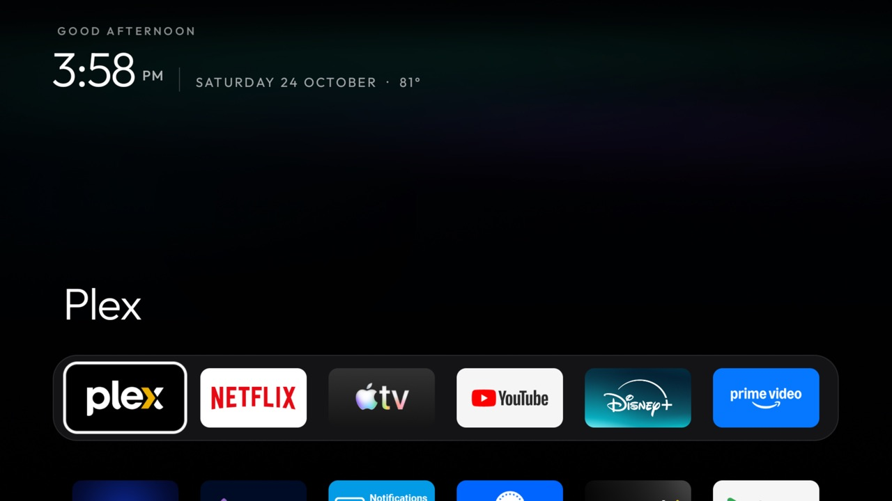
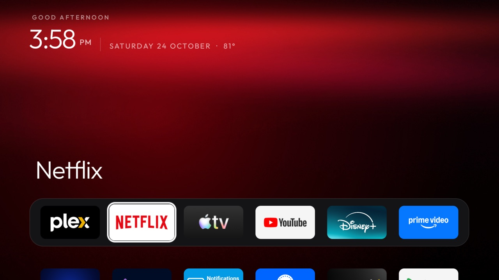
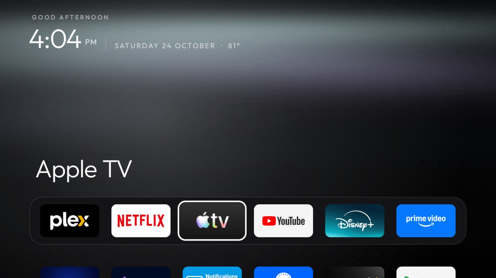
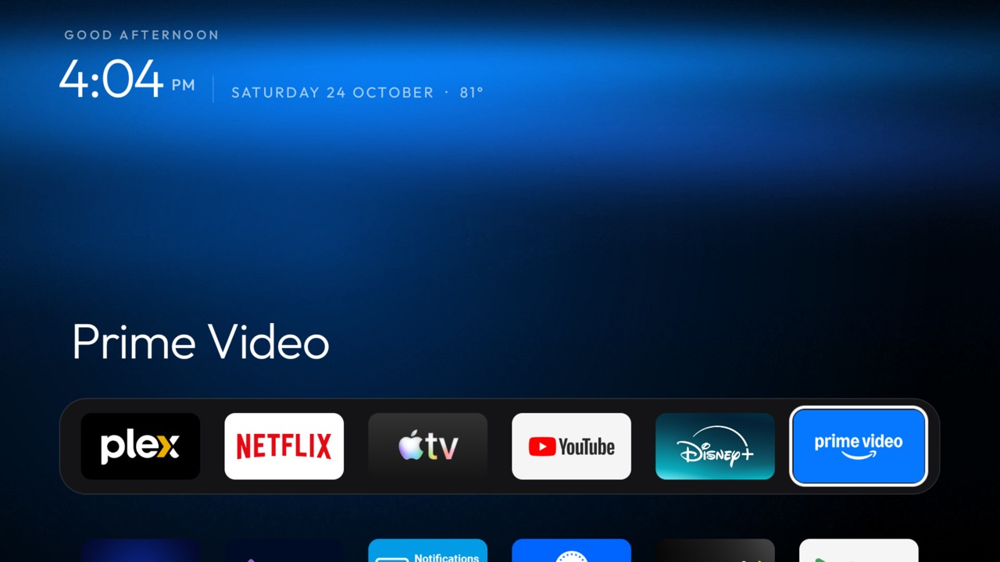
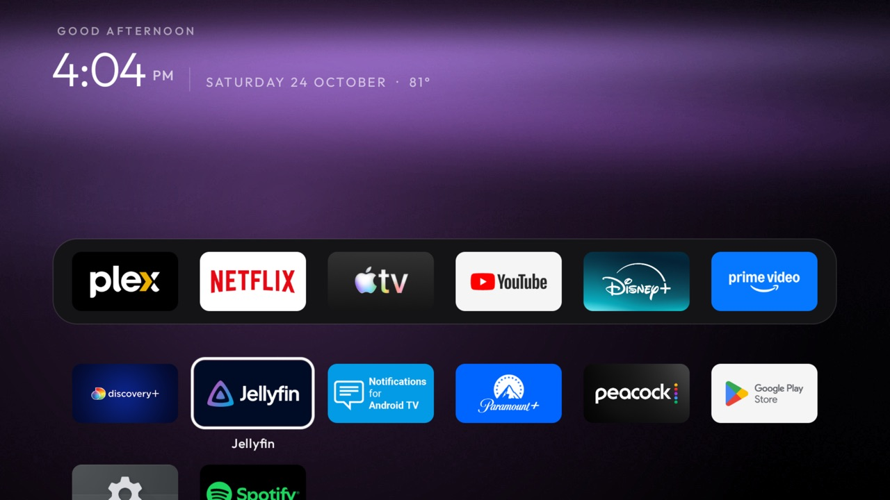

# Super Shield

An NVIDIA SHIELD TV Pro (2019) without the bloat, with a clean Apple TV style home screen, an aurora that takes
each app's colour, and native-feeling Home Assistant controls (outside temperature, scenes, cameras) one press
of the remote away.

Built on [cleanyourtv](https://github.com/Gathin23/cleanyourtv) by [@Gathin23](https://github.com/Gathin23) (MIT):
its debloat tooling, its safety rules and its open-source launcher. This repo adds a SHIELD-specific debloat
list, a few launcher switches, a theme and a Home Assistant add-on. Everything was done and checked on a real SHIELD
over ADB, screenshot by screenshot. The upstream README is still at [`README.md`](../README.md).

| Home | The aurora follows the app |
|---|---|
|  |  |
|  |  |
|  |  |

## What's in it

**Debloat** ([`shield/debloat.txt`](../shield/debloat.txt)): 25 packages disabled, never uninstalled, in seven
small batches with a screenshot after each ([`shield/batches/`](../shield/batches/)):

- NVIDIA and Google telemetry
- partner auto-installs, the NVIDIA Games row and GameStream leftovers
- preloaded apps
- the stock launcher with its sponsored rows
- what this household doesn't use: Assistant, Chromecast built-in, Live Channels, Ambient mode, a few apps, the
  SMB share and Plex Media Server

A reboot re-enabled nothing. Kept on purpose:

- firmware updates
- `tvrecommendations`: without it the SHIELD phone remote breaks
- the remote, Bluetooth and controller services, audio and AI upscaling
- Play Store and Play Services, and every core Android package

**Launcher** ([`launcher/`](../launcher/), cleanyourtv's, with these off-by-default switches added):

| Key | What it does |
|---|---|
| `wallpaper_tint` | The wallpaper's light shifts toward the focused app's colour (a GPU colour filter, no extra memory) |
| `app_colors` | An app's colour by hand, `"package=#RRGGBB"`, where the sampled one is wrong (Plex black, Apple TV silver) |
| `glass_style: outline` | A solid white focus line with a thin gap around the tile, instead of the blurred glass |
| `show_settings_button` | Hide the Settings button when the remote's own ≡ button opens Settings |
| `quick_panel_app` | Another app's panel as the first row of the ≡ quick settings panel |
| `outside_temp_uri` | A local provider's temperature after the date: "SATURDAY 24 OCTOBER · 81°" |
| `hold:` on a settings key | Holding ≡ opens its `hold:` app (Home Controls); a tap still opens quick settings |

The launcher still has no `INTERNET` permission: the temperature comes from the add-on over a local provider.
The release APK is 512,317 bytes, under cleanyourtv's 512 KB gate.

**Theme** ([`themes/aurora-tint/`](../themes/aurora-tint/)): Aurora with `wallpaper_tint` 85, the colour
fixes, the outline, an empty top bar (no network pill, no Settings button) and the Home Controls wiring.

**Home Controls add-on** ([`addons/home-panel/`](../addons/home-panel/)): a glass panel with the outside
temperature (a Tempest via Home Assistant), scenes and full-screen cameras (UniFi Protect through Home
Assistant's camera proxy). It's the only piece that talks to the network, and only to your Home Assistant.

## Use it on your own SHIELD

You need a Mac or Linux box, the SHIELD on the same network, and on the SHIELD: Settings → Device Preferences →
About → press Build 7 times, then Developer options → **Network debugging** on.

```bash
python3 -m venv tools/venv && tools/venv/bin/pip install -r tools/requirements.txt
export TV_HOST=<shield ip>
tools/venv/bin/python -I tools/tv.py --probe          # accept "Allow USB debugging?" on the TV
```

macOS can block a coding assistant's own connections to the LAN (Local Network privacy). Then run
`tools/venv/bin/python -I tools/relay.py <shield ip>` in an ordinary terminal and use
`TV_HOST=127.0.0.1 TV_PORT=15555` ([`tools/relay.md`](../tools/relay.md)).

1. **Back up first:** save `pm list packages`, `getprop` and `settings list global|secure|system` into `backup/`
   (git-ignored; it holds serials and device IDs).
2. **Debloat in batches:** comment out what you use in [`shield/debloat.txt`](../shield/debloat.txt) and
   `shield/batches/`, then `shield/apply-batch.sh shield/batches/batch-1-telemetry.txt`, and so on.
3. **Launcher:** JDK 17 (Homebrew `openjdk@17`) and the Android command-line tools with `platforms;android-34` and
   `build-tools;34.0.0`. Edit the dock in `launcher/app/src/main/res/values/config.xml`, then run
   `./build-and-install.sh`. It disables the stock launcher only after the new one is confirmed as Home.
4. **Theme:** `tools/theme.sh themes/aurora-tint`.
5. **Home Controls:** see [`addons/home-panel/README.md`](../addons/home-panel/README.md) for the token file and
   [`entities.example.json`](../addons/home-panel/entities.example.json).
6. **Close ADB when done:** in Developer options, revoke USB debugging authorisations and switch Network debugging
   and USB debugging off. Reboot, then check with `tools/venv/bin/python -I tools/adb-closed.py <shield ip>`; it
   should say the port refused the connection.

**Undo:** `./restore.sh` re-enables everything in the list, gives Home back to the stock launcher and puts the
screensaver and Private DNS back (`--keep-launcher` keeps the new home).

## Notes

- **The remote:** ≡ sends `KEYCODE_MENU` (82). With `settings_key_keycodes: [82]` and `settings_key_panel`, the
  launcher's `HomeKeyService` answers it. Android switches that helper off on every reinstall, which is why
  `./build-and-install.sh` sets `HOME_KEY_SERVICE=1`. Holding volume still ramps with the helper on.
- **A SHIELD has no HDMI inputs or tuner,** so the launcher hides its Inputs pill, and Live Channels needed
  `HANDLERS_ALLOW=1` past `tools/disable.sh`'s input-handler guard.
- **After a SHIELD Experience update,** check `pm list packages -d` against the list; updates can re-enable packages.
- **Private data stays local.** `backup/`, `shots/`, `work/`, `tools/adbkey/` and any `*secret*.json` are
  git-ignored. Home Assistant tokens live in the add-on's private storage on the TV, never in the repo.

## Licence and credits

MIT, as upstream: [`LICENSE`](../LICENSE), © Gathin and contributors; the additions here are under the same licence.
Outfit font: SIL Open Font License ([`launcher/FONT-LICENSE-OFL.txt`](../launcher/FONT-LICENSE-OFL.txt)).
Rocket and add-on icons: Material Icons, Apache 2.0. Not affiliated with NVIDIA, Google, Apple, Home Assistant or
Ubiquiti.
