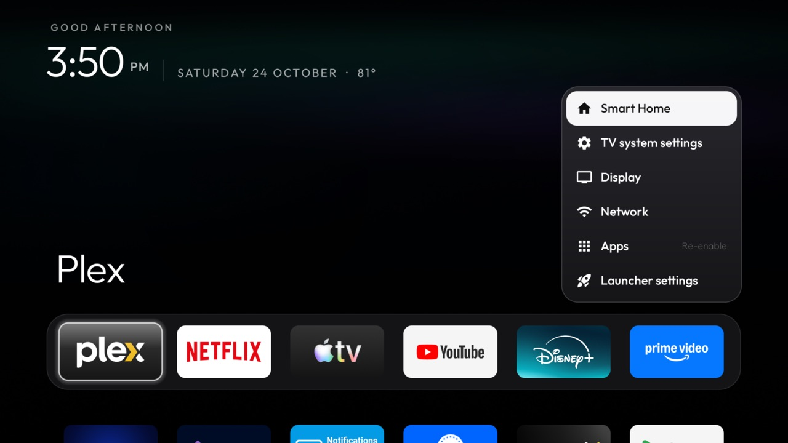

# Home Controls

A small glass panel for [Home Assistant](https://www.home-assistant.io) that looks like part of the launcher:
the outside temperature, a few scenes and your cameras, one press of the remote away. It also hands the
temperature to the launcher, which shows it after the date on Home. A community add-on, not made by or affiliated
with the Home Assistant project.



| Part | Shows | With the remote |
|---|---|---|
| Outside | One temperature sensor (a Tempest weather station here), rounded: `81°` | Shown only |
| Scenes | The `scene.*` entities you list | OK runs one, shows "Done" and closes the panel |
| Cameras | The `camera.*` entities you list, in your order | OK opens one full screen; ◀ ▶ switches; Back closes |

**Opening it with this repo's launcher:** `quick_panel_app` puts it as the first row of the quick settings panel,
and an `app_keys` entry such as `hold:82:com.onk.homepanel` opens it by holding the remote's Settings (≡) button.
`outside_temp_uri` (`content://com.onk.homepanel.weather/now`) puts the temperature after the date.
See [`themes/aurora-tint/config.json`](../../themes/aurora-tint/config.json). On any other home it is an ordinary app.

## Setup

You need the server's address (`http://192.168.1.10:8123`) and a long-lived access token: in Home Assistant, open
your profile, then Security, then Long-lived access tokens, Create token. Keep both in a file outside the repo's
tracked folders. `backup/` is git-ignored; `read -s` keeps the token out of your shell history:

```bash
mkdir -p backup && umask 077 && read -rs "T?Token: " && \
  printf '{"url": "http://192.168.1.10:8123", "token": "%s"}\n' "$T" > backup/home-panel-secret.json && unset T
```

Then list the entities in a second file, like [`entities.example.json`](entities.example.json), and install. Each file
sets only the keys it has, so the entities can change later without pushing the token again:

```bash
TV_HOST=<tv ip> addons/home-panel/install.sh backup/home-panel-secret.json my-entities.json
```

The app takes each file into its own storage through a provider only the ADB shell can write to, and deletes it.

## Permissions

| Permission | Why |
|---|---|
| `INTERNET` | Your Home Assistant server, and nothing else: no telemetry, no update checks, no ads. |

Plain `http://` is allowed for the home network. The token stays in the app's own storage (backups are off) and is
sent only to the address you gave, as `Authorization: Bearer`. The temperature provider is read-only and returns
one value. No background service: the temperature is fetched at most every five minutes, and only while the
launcher's Home or the panel is on screen. No libraries.

## Build and install

JDK 17 and Android SDK platform 34 with build-tools 34.0.0, as for the launcher:

```bash
TV_HOST=<tv ip> addons/home-panel/install.sh [config.json ...]
```

## Limits

- **Cameras** come through Home Assistant's MJPEG proxy (`/api/camera_proxy_stream`), so a few frames a second,
  not smooth video. It works for any camera entity, UniFi Protect's included, with no video library.
- **Self-signed HTTPS** certificates are refused. Use `http://` on the home network or a public certificate.
- **The launcher reads the add-on by package name** (`com.onk.homepanel` in its manifest's `<queries>`). Upstream
  cleanyourtv keeps the launcher free of add-on references; this fork makes that one exception.

## Tested on

NVIDIA SHIELD TV Pro 2019 (`mdarcy`, Android TV 11), against a real Home Assistant: the temperature from a
WeatherFlow Tempest sensor, five UniFi Protect cameras through the camera proxy, the quick-settings row and the
held Settings button pressed on the real SHIELD remote.

## Maintainer

[@daveonkels](https://github.com/daveonkels)
